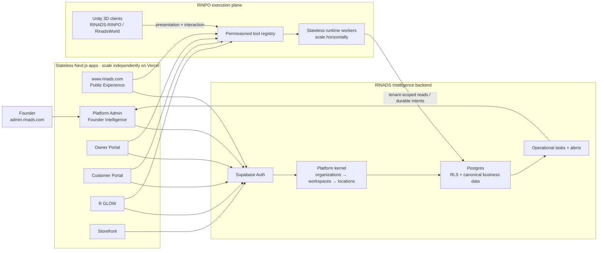

# Founder Intelligence control centre

## Placement and access

Founder Intelligence lives at `/founder-intelligence` in `apps/platform-admin`.
That app is the existing RINADS control plane at `admin.rinads.com`, already
owns platform-wide tenant administration, and already resolves the canonical
Supabase session and tenancy context. A new app would duplicate those security
boundaries and deployment credentials.

The route has its own server layout and accepts only the existing system roles:

- `founder`
- `super_admin` (the current platform-owner role)

Middleware requires a valid Supabase session first. The server layout then
checks canonical membership and role data before rendering. UI visibility is
not treated as authorization. Production continues to fail closed when demo
auth or demo data is enabled.

## Founder Today and Attention

Founder Intelligence is an exception-oriented control surface rather than a
second ERP. `Today` combines direct production facts from the existing RINPO
control snapshot and canonical operations data:

- open operational work;
- work due today in Asia/Kolkata;
- overdue and blocked work;
- pending runtime approvals;
- pending governed RINPO actions;
- the currently selected RINPO model provider/model.

`Attention` is deterministic. It is built from disconnected/degraded sources,
non-READY configured Vercel production projects, overdue/blocked/urgent work,
unacknowledged operational alerts, pending RINPO approvals or actions, an
unconfigured selected provider, and an explicit deployment-parity check between
the public website and platform-admin projects when both return Git commit
metadata.

No model is allowed to invent urgency, health percentages, or business facts
for this view. Future prioritization/recommendation layers must label model
judgement separately from source facts.

## Canonical work pulse

Founder Intelligence does not introduce a second task engine. The read-only
work projection uses the existing Supabase tables created by the operations
schema:

- `operational_tasks`
- `operational_alerts`

The control plane reads those rows server-side using the existing platform
service credential only after founder/super-admin route authorization. It
returns exact counts for open, blocked, overdue, due-today, urgent and
unacknowledged-alert states, plus a bounded list of open tasks for the Work
Pulse card.

`due today` is evaluated against the India operating day (`Asia/Kolkata`) and
converted to an explicit UTC range for PostgREST. No write path is added in
this slice; task creation/update continues to use the existing operations and
RINPO runtime contracts.

## Runtime map

## Scaling and trust boundaries

- **Next.js apps:** remain stateless and independently deployable. Vercel
  production deployments can scale per app without creating another source of
  business truth.
- **Supabase:** PostgreSQL is the durable authority. Organization RLS remains
  the security boundary; workspaces and locations are subordinate scopes.
  Connection, compute, storage, and Auth limits must be monitored against the
  selected Supabase plan rather than inferred in this dashboard.
- **RINPO runtime:** permissioned, idempotent workers can scale horizontally.
  Workers use tenant context and durable runtime records; RINPO never bypasses
  RBAC/RLS or receives unrestricted model-to-database access.
- **Unity:** `RINADS-RINPO` and `RinadsWorld` are client/presentation repos, not
  authoritative data stores.

RINPO's product promise applies here: the dashboard reports direct source
responses and canonical rows only. It does not forecast, synthesize, or invent
health percentages.

## Status adapters

| Source | Adapter | Operational means | Not connected when |
| --- | --- | --- | --- |
| Supabase | Auth health + PostgREST root | Both configured endpoints return success | Public project URL or anon key is absent |
| Workspace registry | Service-role query of `workspaces`, organizations, and location counts | Canonical query succeeds | Service role credentials are absent |
| Operational work | Server-side PostgREST reads/counts of `operational_tasks` and `operational_alerts` | Canonical task/alert reads and counts succeed | Service role credentials are absent |
| Vercel | Latest production deployment per configured project, including branch/commit metadata when returned | Every configured project reports `READY` | Read token or project IDs are absent |
| RINPO runtime | Configured HTTP health endpoint | Endpoint returns 2xx | No runtime health URL is configured |

The Vercel source exposes each configured project separately so the founder can
see which surface is degraded instead of only a fleet-level count. When both
`www.rinads.com` and `admin.rinads.com` return Git commit SHAs, Founder
Intelligence reports a parity exception if they differ. This is an observation,
not an automatic deployment decision; independent app deployment policies can
still make divergence intentional.

Timeouts and non-2xx responses become `degraded` or `unavailable`; they never
become guessed values. Secrets are read server-side from environment variables
only.

## External runtime boundaries

The phone/business runtime is maintained separately in
`rinads-india/rinads-rinpo-AI-Native-Business-Communication-OS`. Unity work is
maintained in `RINADS-RINPO` and `RinadsWorld`. This monorepo currently exposes
no common health contract for those repositories, so Founder Intelligence
defines a minimal HTTP adapter through `RINPO_RUNTIME_HEALTH_URL`. Until the
runtime supplies that endpoint, the UI intentionally reports **Not connected**.
